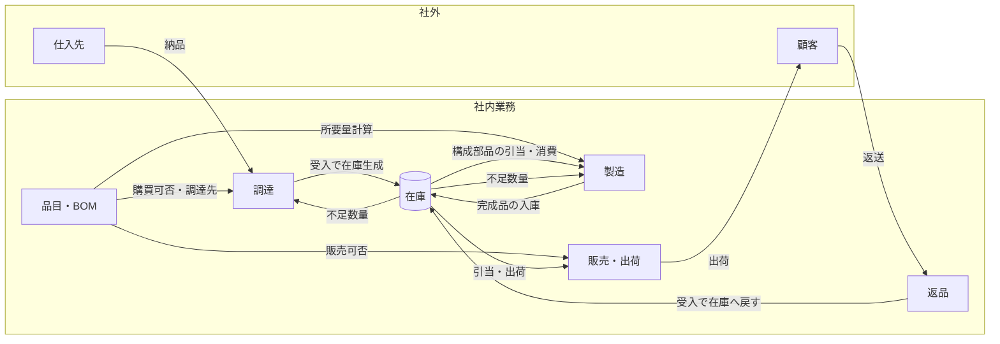
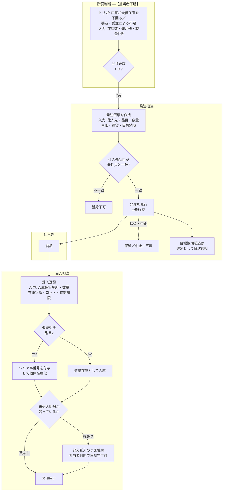
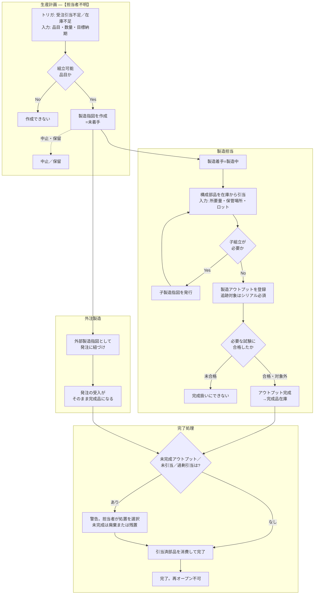
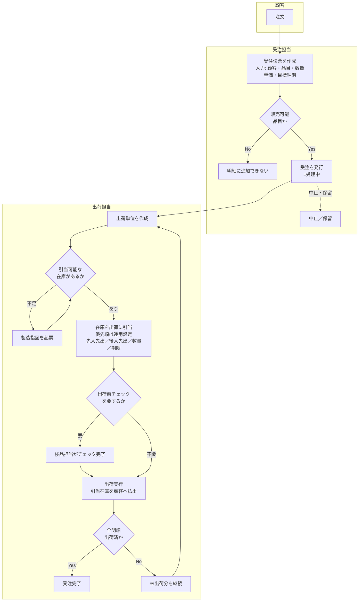
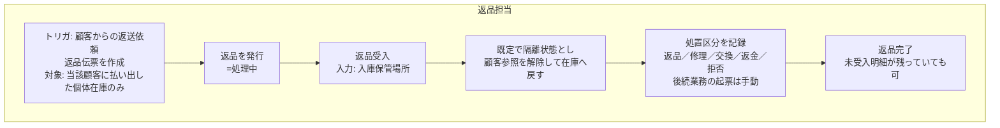
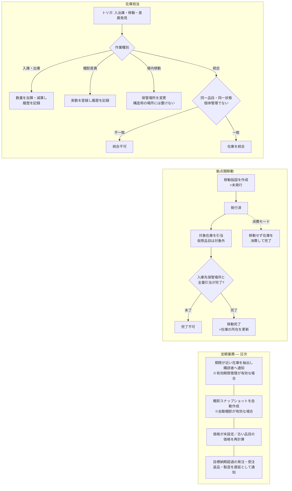

# 業務定義書（As-Is）― 在庫・調達・製造・販売業務

## 0. 本書について

| 項目 | 内容 |
|---|---|
| 目的 | 現行業務（As-Is）の業務要件と業務フローを、現行システムのソースコードおよび付属ドキュメントから抽出・推定して文書化する |
| 対象リポジトリ | `madmerger/InvenTree`（解析リビジョン `c4c493d3f`） |
| 対象バージョン | InvenTree `1.6.0 dev` / API `v550`（`2026-09-22`） [src/backend/InvenTree/InvenTree/api_version.py:8] A |
| 作成方法 | ソースコードのバリデーションメッセージ・定数・状態定義・定期実行処理、および `docs/docs/` 配下の製品ドキュメントからの抽出 |
| 作成日 | 2026-09-24 |

### 0.1 本書の限界

1. **本書の出典はすべて「製品としてのシステム」である。** 実際の運用組織における運用ルール・例外処理・承認体制は出典に存在しないため、本書には書いていない（第8章のヒアリング項目に送っている）。
2. **設定値の既定値は業務ルールではない。** 現行システムは多くの業務挙動を管理設定で切り替える構造であり、本書が記載する既定値は「未設定時の挙動」である。運用中インスタンスの実設定値は本解析の対象外であり、確認が必要（第8章 Q-01）。
3. **業務量・組織体制・承認権限・KPI は原理的にコードから読み取れない。** 空欄であること自体が診断結果であり、推測で埋めていない。
4. **製品ドキュメントは操作手順書の性格が強い。** 画面操作手順は業務要件ではないため本書では除外し、操作の背後にある業務ルールのみを記載した。
5. 標準構成より薄い章（第2章 役割・体制）があるのは、出典側に該当記述が存在しないためである。水増しはしていない。

### 0.2 確信度の定義

| 記号 | 水準 | 定義 |
|---|---|---|
| **A** | 確定 | 出典に明示的に記述、またはコードから一意に読み取れる |
| **B** | 推定（高） | 複数箇所から論理的に導出できる。直接の記述はない |
| **C** | 推定（中） | 断片的記述、または他領域との構造的対称性からの類推。要確認 |
| **D** | 推測（低） | 出典に根拠なし。必ずヒアリングで埋める |
| **⚠** | 矛盾 | 出典内に相互に矛盾する記述が存在する |
| **―** | 記述なし | 該当する記述が一切ない |

### 0.3 出典表記

- `[path:行番号]` … ソースコード。パスは `src/backend/InvenTree/` からの相対。
- `[docs/docs/…md §章]` … リポジトリ内ドキュメント。

---

## 1. 業務全体像

### 1.1 業務領域一覧

| # | 業務領域 | 業務目的 | 出典 | 確信度 |
|---|---|---|---|---|
| 1 | 品目・BOM管理 | 取扱品目と構成（部品表）を維持し、製造所要量算出の基礎とする | [part/models.py:4304] | A |
| 2 | 調達（購買） | 社外から購入する品目を発注し、受入により在庫に変換する | [docs/docs/purchasing/purchase_order.md §Purchase Orders] | A |
| 3 | 製造 | BOMに基づき構成部品を引当・消費し、完成品を在庫として生成する | [docs/docs/manufacturing/build.md §Build Orders] | A |
| 4 | 販売・出荷 | 顧客要求に対し在庫を引当・出荷し、在庫を社外に払い出す | [docs/docs/sales/sales_order.md §Sales Orders] | A |
| 5 | 返品（RMA） | 顧客に払い出した品目を受け戻し、処置区分を判定する | [docs/docs/sales/return_order.md §Return Orders] | A |
| 6 | 在庫管理 | 保管場所間の移動、数量調整、棚卸、有効期限管理を行う | [docs/docs/stock/adjust.md] | A |
| 7 | 取引先管理 | 仕入先・顧客・製造者を登録し、取引の可否を管理する | [docs/docs/concepts/company.md] | A |
| 8 | 価格管理 | 品目原価・販売価格・通貨を維持する | [docs/docs/concepts/pricing.md] | A |

### 1.2 領域間データフロー

（出典: 1.1 の各出典から構成。確信度 **B**）

---

## 2. 役割・体制

出典から読み取れるのは「システム上の職掌区分」までであり、**実組織の部署・人数・兼務・承認権限は出典に存在しない**（第8章）。

| 職掌区分 | 業務上の意味 | 出典 | 確信度 |
|---|---|---|---|
| 品目カテゴリ／品目／BOM | 品目マスタと部品表の維持 | [users/ruleset.py:43-45] | A |
| 保管場所／在庫 | 保管場所と在庫の維持・調整 | [users/ruleset.py:46-47] | A |
| 製造指図 | 製造の発行・引当・完了 | [users/ruleset.py:48] | A |
| 発注 | 購買の発行・受入 | [users/ruleset.py:49] | A |
| 受注 | 販売・出荷 | [users/ruleset.py:50] | A |
| 返品 | 返品受入・処置判定 | [users/ruleset.py:51] | A |
| 移動指図 | 拠点間移動 | [users/ruleset.py:52] | A |
| 管理者 | 全業務の設定管理 | [users/ruleset.py:42] | A |

- 各職掌は「閲覧・追加・変更・削除」の4区分で業務行為を分ける [users/ruleset.py:59] **A**
- 各オーダーには**責任者（担当者または担当グループ）**を置く運用が可能であり、責任者未設定を禁止するか否かは設定で切り替わる [order/models.py:423] **A**
- 業務量（月間発注件数・出荷件数・在庫品目数等） ― **―**
- 承認権限・決裁金額 ― **―**（オーダーに「承認」状態は存在しない。第8章 Q-03）

---

## 3. 調達（購買）業務

### 3.1 業務目的

社外から購入する品目を仕入先に発注し、受入によって自社在庫に変換する [docs/docs/purchasing/purchase_order.md §Purchase Orders] **A**

### 3.2 業務フロー

### 3.3 業務ルール

| # | 業務ルール | 出典 | 確信度 |
|---|---|---|---|
| P-01 | 発注は「未発行 → 発行済 → 完了」を基本の進行とし、途中で「保留」「中止」、事後に「不着」「返送」の区分を持つ | [order/status_codes.py:21-27] | A |
| P-02 | 発注明細の品目は、その発注の仕入先が供給する品目でなければならない（「Part supplier must match PO supplier」） | [order/models.py:827] | A |
| P-03 | 発注明細の数量は 0 より大きいこと | [order/models.py:820] | A |
| P-04 | 目標納期は開始日より後でなければならない | [order/models.py:441] | A |
| P-05 | 完了・中止済みの発注は編集できない（「This order is locked and cannot be modified」） | [order/models.py:376] | A |
| P-06 | 受入時には入庫先の保管場所を指定する | [docs/docs/purchasing/purchase_order.md §Receive Line Items] | A |
| P-07 | 受入済みの明細はその時点で在庫になる（「Each item marked as "received" is automatically converted into a stock item」） | [docs/docs/purchasing/purchase_order.md §Receive Line Items] | A |
| P-08 | 追跡対象品目はシリアル番号を指定して個体単位で受け入れる。仮想品目にはシリアル番号を付与できない | [order/models.py:1158] | A |
| P-09 | 未受入明細が無くなった時点で発注は自動的に完了扱いとなる（既定運用。設定で無効化可） | [order/models.py:1311-1317]、[common/setting/system.py:1018] | A |
| P-10 | 受入数量が発注数量に満たなくても、担当者判断で発注を完了できる | [docs/docs/purchasing/purchase_order.md §Complete Order] | A |
| P-11 | 目標納期を過ぎた未完了発注は「遅延」として日次で検出し、責任者に通知する | [order/tasks.py:72] | A |
| P-12 | 適用通貨は「明細 → 発注 → 仕入先 → 全社既定通貨」の優先順で決まる | [docs/docs/purchasing/purchase_order.md §Currency] | A |
| P-13 | 明細金額 = 数量 × 単価 ×（1 − 値引率/100）。値引率の既定は 0% | [docs/docs/concepts/pricing.md §Discounts] | A |
| P-14 | 発注承認（誰がどの金額まで発注してよいか） | ― | ― |
| P-15 | 検収・請求照合の運用（三点照合の有無） | ― | ― |

### 3.4 帳票・通知

- 発注書（Purchase Order Report）を発注単位で出力する [docs/docs/report/samples.md §Purchase Order] **A**
- 受入時に責任者へ「入荷あり」の通知を配信する [order/models.py:1320-1325] **A**

---

## 4. 製造業務

### 4.1 業務目的

BOM（部品表）に基づき構成部品を引当・消費し、完成品を在庫として生成する [docs/docs/manufacturing/build.md §Build Orders] **A**

### 4.2 業務フロー

### 4.3 業務ルール

| # | 業務ルール | 出典 | 確信度 |
|---|---|---|---|
| M-01 | 製造指図は「未着手 → 製造中 → 完了」を基本進行とし、「保留」「中止」を持つ | [build/status_codes.py:19-23] | A |
| M-02 | 所要量 = 構成数量 × 員数 × 製造数量 に歩留ロス率を乗じ、段取り必要数を加算し、指定倍数に切り上げる | [part/models.py:4304-4349] | A |
| M-03 | 歩留ロス率は 0〜100% の範囲で構成部品ごとに設定する | [part/models.py:4051] | A |
| M-04 | 段取り必要数は「製造1回あたりの余分な必要数」として構成部品ごとに設定する | [part/models.py:4041] | A |
| M-05 | 切断材（ケーブル・チューブ等）は「員数 × 単位長さ」で総所要量を算出する | [part/models.py:4073] | A |
| M-06 | 引当は消費の予約であり、在庫の実消費は製造完了時に行う | [docs/docs/manufacturing/build.md §Allocating Stock] | A |
| M-07 | 休止中の品目に対する製造指図は作成できない（設定により強制） | [build/models.py:198]、[common/setting/system.py:846-852] | A |
| M-08 | 設計確定（ロック）されていない品目の製造を禁止する運用を選択できる | [build/models.py:205] | A |
| M-09 | 製造指図の対象品目は作成後に変更できない | [build/models.py:235] | A |
| M-10 | 追跡対象の完成品にはシリアル番号を付与する | [build/models.py:1144] | A |
| M-11 | 必要な試験に合格していない完成品は完成扱いにできない | [build/models.py:1418] | A |
| M-12 | 子製造指図が未完了のまま親を完了させることを禁止する運用を選択できる | [build/models.py:998]、[common/setting/system.py:852] | A |
| M-13 | 未完成アウトプットが残る状態での完了を禁止する運用を選択できる | [build/models.py:1003] | A |
| M-14 | 完了または中止した製造指図は再開できない | [docs/docs/manufacturing/build.md §Complete Build Order] | A |
| M-15 | 外注製造は発注と紐づけ、受入品をそのまま完成品として計上する。対象品目は購買可能かつ仕入先品目が登録されていること | [docs/docs/manufacturing/external.md]、[order/models.py:2298] | A |
| M-16 | 目標納期を過ぎた未完了製造指図は日次で遅延検出する | [build/tasks.py:564] | A |
| M-17 | 製造の着手可否判断基準（誰がいつ発行するか）・ロットサイズ方針 | ― | ― |

---

## 5. 販売・出荷・返品業務

### 5.1 業務目的

- 販売: 顧客要求に対して在庫を引当・出荷し、社外に払い出す [docs/docs/sales/sales_order.md §Sales Orders] **A**
- 返品: 顧客に払い出した品目を受け戻し、処置区分を判定する [docs/docs/sales/return_order.md §Return Orders] **A**

### 5.2 業務フロー（販売・出荷）

### 5.3 業務フロー（返品）

### 5.4 業務ルール（販売・出荷）

| # | 業務ルール | 出典 | 確信度 |
|---|---|---|---|
| S-01 | 受注は「未発行 → 処理中 → 出荷済 → 完了」を基本進行とし、「保留」「中止」「不着」「返送」の区分を持つ | [order/status_codes.py:64-71] | A |
| S-02 | 販売可能属性を持つ品目のみ受注明細に登録できる | [order/models.py:2508]、[docs/docs/sales/sales_order.md §Add Line Items] | A |
| S-03 | 出荷は受注に対して1件以上作成し、在庫の引当は出荷単位に対して行う | [docs/docs/sales/sales_order.md §Allocate Stock Items] | A |
| S-04 | 引当数量は対象在庫の数量を超えられない | [order/models.py:3141] | A |
| S-05 | 個体管理（シリアル）在庫の引当数量は 1 である | [order/models.py:3164] | A |
| S-06 | 出荷先住所は当該顧客に属する住所でなければならない | [order/models.py:2670] | A |
| S-07 | 出荷済みの出荷単位は再出荷できない | [order/models.py:2801] | A |
| S-08 | 出荷前チェックを必須とする運用を選択できる（未チェックでの出荷を禁止） | [order/models.py:2811]、[common/setting/system.py:937] | A |
| S-09 | 未完了の出荷／未引当がある受注は完了できない | [order/models.py:1800-1805] | A |
| S-10 | 全明細の出荷完了をもって受注を完了とする運用を選択できる | [common/setting/system.py:945] | A |
| S-11 | 必須試験が未完了の在庫の出荷を禁止する運用を選択できる | [common/setting/system.py:982] | A |
| S-12 | 自動引当は複数の保管場所・ロットから在庫をまとめて引き当てる。引当優先順は運用設定で選ぶ（先入先出・後入先出・数量・有効期限） | [docs/docs/sales/sales_order.md §Auto Allocation] | A |
| S-13 | 出荷済み出荷単位の引当は削除できない | [docs/docs/sales/sales_order.md §Allocate Stock Items] | A |
| S-14 | 目標納期を過ぎた未出荷受注は日次で遅延検出する | [order/tasks.py:142] | A |
| S-15 | 与信限度・受注承認・出荷可否の与信判定 | ― | ― |

### 5.5 業務ルール（返品）

| # | 業務ルール | 出典 | 確信度 |
|---|---|---|---|
| R-01 | 返品は「未発行 → 処理中 → 完了」を基本進行とし、「保留」「中止」を持つ | [order/status_codes.py:100-104] | A |
| R-02 | 返品対象は、当該顧客に払い出された個体管理在庫に限る | [docs/docs/sales/return_order.md §Add Line Items] | A |
| R-03 | 返品受入には入庫先保管場所の指定が必要 | [order/models.py:3472-3489] | A |
| R-04 | 受入れた返品在庫は既定で「隔離」状態とし、顧客参照を解除して在庫に戻す | [order/models.py:3482-3489] | A |
| R-05 | 返品数量は当該在庫の数量を超えられない | [order/models.py:3586] | A |
| R-06 | 明細ごとに「返品・修理・交換・返金・拒否」の処置区分を記録する。区分を選んでも交換・返金・修理の後続業務は自動起票されない | [order/status_codes.py:131-136]、[docs/docs/sales/return_order.md §Line Item Status] | A |
| R-07 | 未受入明細が残っていても返品を完了できる | [docs/docs/sales/return_order.md §Complete Return Order] | A |
| R-08 | 返品業務自体を使用するか否かは運用設定（既定は無効） | [common/setting/system.py:882] | A |
| R-09 | 目標納期を過ぎた未受入返品は日次で遅延検出する | [order/tasks.py:209] | A |
| R-10 | 隔離在庫の判定・処置期限・返金条件 | ― | ― |

---

## 6. 在庫管理業務

### 6.1 業務目的

保管場所ごとに在庫の所在と数量を管理し、移動・調整・棚卸・有効期限管理を行う [docs/docs/stock/adjust.md] **A**

### 6.2 業務フロー

### 6.3 業務ルール

| # | 業務ルール | 出典 | 確信度 |
|---|---|---|---|
| I-01 | 在庫の状態区分は「良品・要注意・破損・廃棄・不合格・紛失・隔離・返却品」 | [stock/status_codes.py:22-29] | A |
| I-02 | 在庫の異動は「棚卸・入庫・出庫・移動・組付・分解・製造投入・製造完成・出荷・受入・返品受入」等の事由とともに履歴として残す | [stock/status_codes.py:104-146] | A |
| I-03 | 個体管理在庫は削除できない | [stock/models.py:582] | A |
| I-04 | 追跡対象品目の在庫数量は整数であること | [stock/models.py:1064] | A |
| I-05 | 仮想品目に在庫は持てない | [stock/models.py:1070] | A |
| I-06 | 構造用の保管場所（分類のための箱）には在庫を置けない | [stock/models.py:1966] | A |
| I-07 | 在庫の統合は、同一品目・同一在庫状態が条件であり、個体管理在庫は統合できない | [stock/models.py:2640-2664] | A |
| I-08 | 在庫として存在しない品（出荷済・消費済等）は移動できない | [stock/models.py:3092] | A |
| I-09 | 在庫数が最低在庫を下回る品目を「在庫不足」とみなす | [part/models.py:2574-2576] | A |
| I-10 | 発注要数 = 受注・製造による所要量 −（在庫数と最低在庫のいずれか大きい方）− 発注残 − 製造中数。負値は 0 とする | [part/models.py:1531-1557] | A |
| I-11 | 有効期限は在庫ごとに設定し、品目に既定の有効日数を持たせて自動設定できる | [part/models.py:1242] | A |
| I-12 | 有効期限管理を行うかは運用設定（既定は無効） | [common/setting/system.py:751] | A |
| I-13 | 期限切れ在庫の販売・製造投入は既定で禁止。設定で許可できる | [common/setting/system.py:758]、[common/setting/system.py:773] | A |
| I-14 | 期限が近い在庫は日次で抽出し、購読者に通知する | [part/tasks.py:162]、[common/setting/system.py:764] | A |
| I-15 | 棚卸は「在庫エントリ件数」と「総在庫数量」と「在庫金額（レンジ）」を時点記録として残す | [docs/docs/part/stocktake.md] | A |
| I-16 | 自動棚卸を有効にする場合、既定の作成間隔は 7 日 | [common/setting/system.py:1253] | A |
| I-17 | シリアル番号を全社で一意にするかは運用設定（既定は品目ごとの一意） | [common/setting/system.py:722] | A |
| I-18 | 在庫評価方法（移動平均・先入先出等の会計方針） | ― | ― |
| I-19 | 棚卸の実施頻度・実地棚卸の体制・差異許容範囲 | ― | ― |

### 6.4 取引先・価格に関する業務ルール

| # | 業務ルール | 出典 | 確信度 |
|---|---|---|---|
| C-01 | 1つの取引先は、顧客・仕入先・製造者のいずれか／複数の役割を兼ねる | [docs/docs/concepts/company.md] | A |
| C-02 | 取引を終了した取引先は削除せず「無効」にし、過去の取引履歴を残したまま新規取引の対象外とする | [docs/docs/concepts/company.md §Disable Company] | A |
| C-03 | 全社の既定通貨を定め、取引ごとに通貨を指定できる | [common/setting/system.py:265] | A |
| C-04 | 品目価格は日次で点検し、未設定・一定日数以上更新されていないものを再計算する（既定 30 日） | [part/tasks.py:249]、[common/setting/system.py:636] | A |
| C-05 | 値引率・支払条件の決裁権限 | ― | ― |

---

## 7. 用語定義

| 用語 | 定義 | 出典 |
|---|---|---|
| 品目（Part） | 管理対象となる物品の定義。購買可否・販売可否・組立可否・追跡要否等の業務属性を持つ | [part/models.py:1288-1306] |
| 組立品 / 構成部品 | 他品目から製造される品目／他品目の製造に使われる品目 | [part/models.py:499 近傍] |
| 追跡対象品目（Trackable） | 個体ごとに一意のシリアル番号で管理する品目 | [part/models.py:1288] |
| 仮想品目（Virtual） | ソフトウェア・ライセンス等、物理在庫を持たない品目 | [stock/models.py:1070] |
| BOM | 組立品1単位に必要な構成部品と数量の一覧 | [part/models.py:4304] |
| 歩留ロス率（Attrition） | 製造時に見込む損失率（0〜100%） | [part/models.py:4051] |
| 段取り必要数（Setup Quantity） | 製造1回ごとに余分に必要となる数量 | [part/models.py:4041] |
| 在庫（Stock Item） | 特定の品目・特定の保管場所・特定の数量の実在庫 | [docs/docs/stock/adjust.md] |
| 保管場所 | 在庫の所在。分類専用の「構造用」場所には在庫を置けない | [stock/models.py:1966] |
| 引当（Allocation） | 特定の在庫を特定の出荷または製造に予約する行為。実消費は完了時 | [docs/docs/manufacturing/build.md §Allocating Stock] |
| 隔離（Quarantined） | 良品として扱えず判定待ちの在庫状態。返品受入時の既定 | [stock/status_codes.py:28] |
| 遅延（Overdue） | 目標納期を過ぎた未完了のオーダー | [order/tasks.py:72] |
| 棚卸（Stocktake） | ある時点の在庫数量・在庫金額の記録 | [docs/docs/part/stocktake.md] |

---

## 8. 未解決事項・ヒアリング項目

優先度: **高** = これがないと次工程（要求定義）が進まない／**中** = 設計判断に影響／**低** = 補足。

| ID | 優先 | 確認事項 | 現状 |
|---|---|---|---|
| Q-01 | 高 | 現行本番環境の運用設定値（有効期限管理・返品業務・移動指図・出荷前チェック・自動完了・自動棚卸の有効／無効）の実態 | 既定値のみ判明。実値は未確認 C |
| Q-02 | 高 | 実組織の部署・担当者数・兼務関係と、各職掌への割当 | ― |
| Q-03 | 高 | 発注・受注・値引・出荷の承認権限と決裁金額基準。現行システムに「承認」状態は存在しない | ― |
| Q-04 | 高 | 業務量（月間の発注・受注・出荷・製造・返品件数、品目数、在庫ロケーション数） | ― |
| Q-05 | 高 | 与信管理の有無と運用（与信超過時の扱い） | ― |
| Q-06 | 高 | 在庫評価方法（会計方針）と原価計算の運用 | ― |
| Q-07 | 中 | 業務サイクル（締め日、月次・期末の処理、棚卸の実施時期と体制） | ― |
| Q-08 | 中 | 検収・請求照合（三点照合）の運用と、システム外で行っている業務範囲 | ― |
| Q-09 | 中 | 返品時の処置判定基準、隔離在庫の滞留上限、交換・返金の後続業務（現行は手動起票） | R-06 より手動であることのみ判明 A |
| Q-10 | 中 | 引当優先順の運用実態（先入先出／後入先出／期限順のいずれを使っているか） | S-12 より選択肢のみ判明 A |
| Q-11 | 中 | 外注製造の利用有無と外注先管理の運用 | M-15 より機能の存在のみ判明 A |
| Q-12 | 中 | 業務例外（イレギュラー出荷、緊急発注、システム外での在庫調整）の頻度と扱い | ― |
| Q-13 | 低 | 帳票の実使用状況（発注書・納品書・ピッキングリスト等の誰宛・何枚） | ― |
| Q-14 | 低 | 通知の受領者と運用（遅延通知・在庫期限通知を誰が見て何をするか） | ― |
| Q-15 | 低 | 品目番号・ロット番号の採番体系に業務的意味があるか（桁ごとの意味づけ） | ― |

---

## 9. 出典資料の信頼度評価

（「未完成マーカー」は `TODO` / `FIXME` / `NEEDS UPDATING` / `????` / `[Note to writer:]` の検出結果。全資料で未検出）

| 出典 | 種別 | 最終更新 | 評価 |
|---|---|---|---|
| 各アプリの models.py / tasks.py / status_codes.py | 実装コード | 継続更新 | **最上位**。稼働している業務挙動そのもの。本書の A 判定の主根拠 |
| common/setting/system.py | 実装コード（設定定義） | 継続更新 | 高。ただし**既定値であり運用実値ではない**点に注意（Q-01） |
| purchasing/purchase_order.md | 製品文書 | 2026-09-15 | 高。コードと整合。ただし操作手順が主体 |
| sales/sales_order.md | 製品文書 | 2026-09-15 | 高 |
| sales/return_order.md | 製品文書 | 2026-08-23 | 高 |
| stock/transfer_order.md | 製品文書 | 2026-08-23 | 高 |
| manufacturing/build.md, external.md | 製品文書 | 2026-07〜09 | 高 |
| part/stocktake.md | 製品文書 | 2026-07-12 | 中〜高。棚卸の設定項目名は現行コードと突合が必要 |
| concepts/pricing.md | 製品文書 | 2026-07-20 | 中〜高 |
| stock/expiry.md | 製品文書 | 2025-06-28 | **中**。他資料より1年以上古い。記述内容はコード側（有効期限関連設定）と整合を確認済 |
| 運用マニュアル・業務手順書・帳票サンプル・組織図 | ― | ― | **存在しない**。第8章の空欄の主因 |

### 9.1 評価にあたっての注意

- 上記の日付はリポジトリのコミット日であり、**記述内容が現場運用と一致していることを保証するものではない**。ドキュメントは製品マニュアルであって運用規程ではない。
- `docs/docs/` 配下に `TODO` / `FIXME` / `NEEDS UPDATING` / `????` / `[Note to writer:]` 等の未完成マーカーは検出されなかった。
- 同一文書内での世代混在（旧仕様の残置）は本解析の範囲では検出されなかった。
- 本書で **⚠**（矛盾）を付した項目はない。コードとドキュメントの間に、業務ルール水準での矛盾は検出されなかった。
