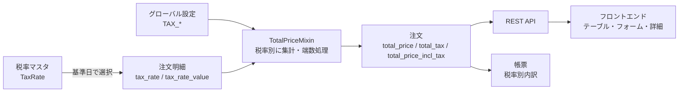

## 文書情報

| 項目 | 内容 |
| --- | --- |
| 文書名 | 消費税率変更対応 開発要件定義書 |
| 対象システム | InvenTree（本リポジトリ: `madmerger/InvenTree`） |
| 対象範囲 | バックエンド（Django / Django REST Framework）、フロントエンド（React / TypeScript）、帳票テンプレート、API |
| 版 | 0.1（ドラフト） |
| ステータス | 要求事項の確認待ち（[3. 要求事項の確認ポイント](#confirmation-points) を参照） |

!!! warning "ドラフト"
    本書は現行コードの調査結果をもとに作成した初版である。`【要確認】` と記した項目は、業務部門・経理部門との合意後に確定値へ置き換えること。

## 1. 背景・目的

### 1.1 背景

消費税率の改正（標準税率および軽減税率の変更）が予定されている。InvenTree は発注（Purchase Order）・受注（Sales Order）・返品（Return Order）の金額を管理しているが、現行バージョンには消費税を計算・表示・印字する機能が存在しない。そのため、現在は税額を InvenTree の外（表計算ソフト・会計システム等）で個別に計算しており、税率改正時に次のリスクがある。

- 改正前後で異なる税率を手作業で適用することによる計算誤り
- 発注書・請求書（帳票）に税率別の内訳を印字できないことによる、適格請求書等保存方式（インボイス制度）の記載要件への不適合
- 改正日をまたぐ注文で、適用税率の判断が担当者ごとに異なること

### 1.2 目的

1. InvenTree 上で税率を管理し、注文明細ごとに適用税率と税額を算出できるようにする。
2. 注文合計に税額と税込合計を表示し、帳票に税率別の内訳を印字できるようにする。
3. 税率改正の適用開始日を境に、新しい税率を自動で適用できるようにする。改正前に確定した注文の金額は変更しない。

### 1.3 適用開始日

| 項目 | 値 |
| --- | --- |
| 改正税率の適用開始日 | `【要確認】YYYY-MM-DD` |
| 本機能の本番リリース期限 | 適用開始日の `【要確認】` 営業日前（受入テストと運用リハーサルの期間を確保すること） |
| 税率マスタへの改正税率の事前登録 | リリース後から適用開始日の前日までに実施する |

## 2. 現状分析

### 2.1 結論

**現行の InvenTree には消費税の計算機能がない。** 税に関係するデータは取引先の税番号（文字列）だけであり、税率・税額・税込金額はどのモデル・API・画面・帳票にも存在しない。

### 2.2 税関連データ

| 対象 | 場所 | 内容 |
| --- | --- | --- |
| `Company.tax_id` | `src/backend/InvenTree/company/models.py`（224-229 行） | `CharField(max_length=50, blank=True)`。取引先の税番号を保存する文字列で、計算には使われない。`company/serializers.py` で API に公開され、`company/api.py` の検索対象（`search_fields`）にも含まれる。 |

### 2.3 価格データの保存形式

- 価格は [django-money](https://github.com/django-money/django-money) の `MoneyField` で保存する。InvenTree では独自のサブクラス `InvenTreeModelMoneyField` / `InvenTreeMoneyField`（`src/backend/InvenTree/InvenTree/fields.py`）を使う。
- [Pricing のドキュメント](../concepts/pricing.md) にあるとおり、InvenTree はユーザーが入力した価格を **生データのまま** 保存する。**税込・税抜の区別はない。**
- 単価を持つフィールドは以下のとおり（`src/backend/InvenTree/order/models.py`）。

| モデル | 単価フィールド | 備考 |
| --- | --- | --- |
| `PurchaseOrderLineItem` | `purchase_price` | プロパティ `price` で参照する |
| `SalesOrderLineItem` | `sale_price` | プロパティ `price` で参照する |
| `ReturnOrderLineItem` | `price` | |
| `PurchaseOrderExtraLine` / `SalesOrderExtraLine` / `ReturnOrderExtraLine` | `price` | 抽象クラス `OrderExtraLine` で定義する。負の値も入力できる（`allow_negative=True`） |
| `TransferOrderLineItem` | なし | 金額を持たないため、本要件の対象外 |

- 部品の価格情報（`src/backend/InvenTree/part/models.py` の `PartPricing`、`PartSellPriceBreak` 等）は、発注明細の `purchase_price` や受注明細の `sale_price` の履歴を集計している。そのため、明細単価の意味（税込か税抜か）を変えると、部品の価格集計にも影響する。

### 2.4 金額計算ロジック

明細の合計は、抽象クラス `OrderLineItem` のプロパティ `total_line_price` で次のように計算する（[Pricing - Line Items](../concepts/pricing.md#line-items)）。

```
Line Total = Quantity * Unit Price * (1 - Discount / 100)
```

注文合計は `TotalPriceMixin.calculate_total_price()` で計算する。処理は次のとおり。

1. `lines`（明細）と `extra_lines`（追加明細）を 1 件ずつ処理する。
2. 各明細の単価を注文通貨（`order.currency`）に換算する（`convert_money`）。
3. 上記の式で明細合計を求めて足し合わせる。
4. 結果を `total_price` フィールドに保存する（小数 4 桁）。

`TotalPriceMixin` は `PurchaseOrder` / `SalesOrder` / `ReturnOrder` が継承している。明細を保存・削除すると、`OrderLineItem.save()` / `delete()` が親の注文を保存し、その際に合計が再計算される。注文がロック済みの場合（`check_locked()`）は明細を変更できない。

### 2.5 表示・帳票・設定

| 領域 | 場所 | 現状 |
| --- | --- | --- |
| グローバル設定 | `src/backend/InvenTree/common/setting/system.py` | `PRICING_DECIMAL_PLACES_MIN` / `PRICING_DECIMAL_PLACES`（表示する小数桁数）、`INVENTREE_DEFAULT_CURRENCY`、`CURRENCY_CODES`、`PURCHASEORDER_CONVERT_CURRENCY` などがある。税に関する設定はない。 |
| 帳票テンプレート | `src/backend/InvenTree/report/templates/report/` | `inventree_purchase_order_report.html` / `inventree_sales_order_report.html` / `inventree_return_order_report.html` は単価・明細合計・`order.total_price` だけを印字する。税率・税額・税込合計の欄はない。 |
| 帳票コンテキスト | `order/models.py` の `PurchaseOrderReportContext` / `SalesOrderReportContext` / `ReturnOrderReportContext` | 税に関する変数はない。 |
| 通貨フォーマット | `src/backend/InvenTree/report/templatetags/report.py` の `render_currency`、`src/frontend/src/defaults/formatters.tsx` の `formatCurrency` | 金額を整形するだけで、税は扱わない。 |
| 部品価格パネル | `src/frontend/src/pages/part/PartPricingPanel.tsx`、`src/frontend/src/pages/part/pricing/` | 税抜・税込の区別なく価格を表示する。 |
| 注文テーブル | `src/frontend/src/tables/purchasing/PurchaseOrderLineItemTable.tsx`、`tables/sales/SalesOrderLineItemTable.tsx`、`tables/sales/ReturnOrderLineItemTable.tsx`、`tables/general/ExtraLineItemTable.tsx`、`tables/purchasing/PurchaseOrderTable.tsx`、`tables/sales/SalesOrderTable.tsx`、`tables/sales/ReturnOrderTable.tsx` | 単価・値引率・合計を表示する。`SalesOrderLineItemTable.tsx` だけは、合計をフロントエンド側で `sale_price × quantity × (1 - discount/100)` と再計算している。 |
| 注文詳細 | `src/frontend/src/pages/purchasing/PurchaseOrderDetailsPanel.tsx`、`pages/sales/SalesOrderDetailsPanel.tsx`、`pages/sales/ReturnOrderDetailsPanel.tsx` | `total_price` だけを表示する。 |
| API バージョン | `src/backend/InvenTree/InvenTree/api_version.py` | 現在は `INVENTREE_API_VERSION = 550`。API を変更するときは、この値を上げて `INVENTREE_API_TEXT` に変更履歴を追記する。 |

## 3. 要求事項の確認ポイント { #confirmation-points }

設計を確定する前に、次の項目を業務部門・経理部門に確認する。「推奨案」は確認時のたたき台であり、合意後に確定値として本書へ反映する。

| No. | 確認項目 | 選択肢 | 推奨案 | 確定値 |
| --- | --- | --- | --- | --- |
| Q1 | 税率の値 | 改正後の標準税率／軽減税率と、それぞれの適用開始日 | 税率マスタに「税率・適用開始日・適用終了日」を登録し、日付で自動的に切り替える | `【要確認】` |
| Q2 | 単価をどちらで登録するか | (a) 税抜で登録 (b) 税込で登録 (c) 注文ごとに選べる | (a) 税抜。既存の `purchase_price` / `sale_price` / `price` の意味と部品の価格集計（2.3）を変えずに済むため | `【要確認】` |
| Q3 | 軽減税率は必要か | 要／不要 | 要。部品ごと・追加明細ごとに税区分を選べるようにする | `【要確認】` |
| Q4 | 適格請求書（インボイス）に対応するか | 要／不要 | 要。自社の登録番号、取引先の登録番号、税率ごとの対価の額・消費税額を帳票に印字する | `【要確認】` |
| Q5 | 端数処理のルール | 切捨て／切上げ／四捨五入 | 切捨て。インボイスの要件に合わせ、端数処理は **1 つの注文につき税率ごとに 1 回** とする | `【要確認】` |
| Q6 | 端数処理の単位 | 注文単位（税率ごと）／明細単位 | 注文単位（税率ごと）。明細の税額は参考値として表示する | `【要確認】` |
| Q7 | 適用税率を決める基準日 | 発行日（`issue_date`）／出荷日・受領日／作成日 | 発行日。発行前の注文は作成日。改正日をまたぐ注文は、明細ごとに税率を変更できる | `【要確認】` |
| Q8 | 既存データの扱い | (a) 税率未設定のまま残す (b) 移行時に一括で税率を付与する | (a)。完了・ロック済みの注文は変更しない。未完了の注文は、確認画面で対象を確かめてから一括付与できるようにする | `【要確認】` |
| Q9 | 非課税・不課税・免税（輸出）の扱い | 税区分として持つ／持たない | 持つ（税率 0% の区分として登録する）。取引先ごとに既定の税区分を設定できるようにする | `【要確認】` |
| Q10 | 外貨建ての注文 | 外貨でも税計算する／JPY の注文だけ計算する | 注文通貨で計算する。端数処理は通貨の補助単位で行う（JPY は 0 桁） | `【要確認】` |
| Q11 | 返品（Return Order）の扱い | 返還インボイスとして印字する／しない | 返品の帳票に税率ごとの返還額・税額を印字する | `【要確認】` |
| Q12 | 本機能の有効化 | 常に有効／設定で ON・OFF | グローバル設定で ON・OFF する（既定は OFF。OFF のときは現行どおりの動作・表示） | `【要確認】` |

!!! info "端数処理の例（Q5）"
    10% 対象の明細合計が ¥4,325、8% 対象の明細合計が ¥1,194 の注文の場合:

    | 税率 | 対象額（税抜） | 計算上の税額 | 切捨て | 切上げ | 四捨五入 |
    | --- | --- | --- | --- | --- | --- |
    | 10% | ¥4,325 | ¥432.5 | ¥432 | ¥433 | ¥433 |
    | 8% | ¥1,194 | ¥95.52 | ¥95 | ¥96 | ¥96 |

    四捨五入は「0.5 は切り上げる」方式（`ROUND_HALF_UP`）とする。Python の `round()` が使う偶数丸め（`ROUND_HALF_EVEN`）は使わない。

## 4. 機能要件

### 4.1 全体像



### 4.2 税率マスタ・グローバル設定（FR-1）

#### FR-1.1 税率マスタ

`common` アプリに、税率マスタのモデル `TaxRate` を追加する（既存の `ProjectCode` と同じ作りで、`InvenTreeMetadataModel` を継承する）。

| フィールド | 型 | 必須 | 説明 |
| --- | --- | --- | --- |
| `name` | `CharField(100)` | 必須 | 表示名（例: 「標準税率」「軽減税率」「非課税」） |
| `category` | 選択肢 | 必須 | `standard` / `reduced` / `exempt`（非課税）/ `non_taxable`（不課税）/ `zero_rated`（免税） |
| `rate` | `DecimalField(max_digits=5, decimal_places=2)` | 必須 | 税率（%）。0 以上 100 以下 |
| `valid_from` | `DateField` | 必須 | 適用開始日 |
| `valid_to` | `DateField` | 任意 | 適用終了日（空欄なら期限なし） |
| `active` | `BooleanField` | 必須 | 無効にした税率は新しい明細で選べない |
| `description` | `CharField(250)` | 任意 | 備考 |

- 同じ `category` で適用期間が重なる税率は登録できない（バリデーションエラーにする）。
- 明細から参照されている税率は削除できない（`on_delete=PROTECT`）。変更は「無効化」と「新しい税率の登録」で行う。
- 管理画面（Admin Center）に「Tax Rates」パネルを追加し、一覧・作成・編集・無効化ができるようにする。API は `/api/tax-rate/`（一覧・詳細）とする。権限は既存の設定系 API と同じとする。
- 改正税率は、適用開始日を未来日にして事前に登録できること。

#### FR-1.2 グローバル設定

`src/backend/InvenTree/common/setting/system.py` に次の設定を追加する。

| キー | 型・既定値 | 説明 |
| --- | --- | --- |
| `TAX_ENABLED` | bool / `False` | 税計算機能の ON・OFF。OFF のときは税の欄を表示せず、現行どおりに動作する |
| `TAX_PRICES_INCLUDE_TAX` | bool / `False` | 単価を税込で入力するかどうか（Q2 の結果を反映する） |
| `TAX_ROUNDING_MODE` | 選択肢 / `floor` | `floor`（切捨て）/ `ceil`（切上げ）/ `round_half_up`（四捨五入） |
| `TAX_ROUNDING_LEVEL` | 選択肢 / `order` | `order`（注文単位・税率ごと）/ `line`（明細単位） |
| `TAX_DEFAULT_CATEGORY` | 選択肢 / `standard` | 部品や取引先に税区分が設定されていないときの既定値 |
| `TAX_DATE_BASIS` | 選択肢 / `issue_date` | 適用税率を決める基準日（Q7） |
| `TAX_INVOICE_REGISTRATION_NUMBER` | 文字列 / 空 | 自社の適格請求書発行事業者の登録番号（`T` + 13 桁）。帳票に印字する |

- 設定画面（`src/frontend/src/pages/Index/Settings/SystemSettings.tsx`）の Pricing の近くに「Tax」グループを追加する。
- [Global Settings](../settings/global.md) のドキュメントに `globalsetting` マクロで追記する。

#### FR-1.3 部品・取引先の既定税区分

- `Part` に `tax_category`（任意。空欄なら `TAX_DEFAULT_CATEGORY` を使う）を追加する。食品などの軽減税率対象品は、部品ごとに設定する。
- `Company` に `tax_category`（任意。輸出免税の取引先などに使う）を追加する。取引先の区分は部品の区分より優先する。
- 既存の `Company.tax_id` は取引先の登録番号として帳票に印字する。登録番号の書式チェック（`T` + 13 桁）は、日本の取引先にだけ警告として行う（`tax_id` は海外の税番号にも使われているため、エラーにはしない）。

### 4.3 注文明細への税率・税額フィールド（FR-2）

抽象クラス `OrderLineItem`（明細と追加明細の両方が継承する）に次のフィールドを追加する。`TransferOrderLineItem` には追加しない（金額を持たないため）。

| フィールド | 型 | 説明 |
| --- | --- | --- |
| `tax_rate` | `ForeignKey(TaxRate, null=True, on_delete=PROTECT)` | 適用する税率。`null` は「税率未設定」を表す |
| `tax_rate_value` | `DecimalField(5, 2, null=True)` | 明細を保存した時点の税率（%）のスナップショット。マスタを変更しても過去の明細の金額は変わらない |

追加するプロパティ（DB には保存しない）:

| プロパティ | 計算式 |
| --- | --- |
| `total_line_price` | **現行どおり**（税抜の明細合計）。後方互換のため意味を変えない |
| `line_tax_amount` | `total_line_price × tax_rate_value / 100`（参考値。`TAX_ROUNDING_LEVEL = line` のときだけ端数処理する） |
| `total_line_price_incl_tax` | `total_line_price + line_tax_amount` |

税率の自動設定ルール:

1. 明細を作成するとき、`tax_rate` が指定されていなければ、取引先の区分 → 部品の区分 → `TAX_DEFAULT_CATEGORY` の順に税区分を決め、基準日（`TAX_DATE_BASIS`）に有効な税率を設定する。
2. 追加明細（送料・手数料など）は部品を持たないため、取引先の区分または既定の区分を使う。フォームで変更できる。
3. `tax_rate` を変更したときは、`tax_rate_value` を新しい税率の値で更新する。
4. ロック済み（`check_locked()`）の注文の明細は、既存のルールどおり変更できない。

`TAX_PRICES_INCLUDE_TAX = True`（税込入力）の場合:

- フォームで入力された税込単価から、`税込単価 × 100 / (100 + 税率)` で税抜単価を求めて保存する。保存する値の意味は常に税抜とする。
- 換算で生じる誤差は、明細ではなく注文合計の税額計算（FR-3）で調整する。調整ルールの詳細は Q2 の確定後に決める。

### 4.4 注文合計への税額・税込合計表示（FR-3）

`TotalPriceMixin` に次のフィールドを追加する（`PurchaseOrder` / `SalesOrder` / `ReturnOrder` が対象）。

| フィールド | 型 | 説明 |
| --- | --- | --- |
| `total_price` | 既存 | **税抜合計**。後方互換のため意味を変えない |
| `total_tax` | `InvenTreeModelMoneyField(null=True)` | 税額の合計 |
| `total_price_incl_tax` | `InvenTreeModelMoneyField(null=True)` | 税込合計（`total_price + total_tax`） |

- `calculate_total_price()` を拡張し、明細と追加明細を 1 回だけループして、税抜合計と税率別の集計を同時に行う。
- 税率別内訳を返すメソッド `get_tax_breakdown()` を追加する。戻り値は次のリストとする。

    ```
    [{"tax_rate": <TaxRate>, "rate": Decimal, "category": str,
      "taxable_amount": Money, "tax_amount": Money}, ...]
    ```

- 端数処理は、`TAX_ROUNDING_LEVEL = order` のとき税率ごとに 1 回、`TAX_ROUNDING_MODE` に従い、注文通貨の補助単位で行う。
- 通貨換算に失敗したとき（`MissingRate`）は、既存の `total_price` と同じく `total_tax` と `total_price_incl_tax` も `None` にする。
- 税率未設定の明細が 1 件でもある場合は、`total_tax` を計算せず `None` にし、画面には「税率未設定の明細があります」と警告を出す。0 円として計算してしまうと、誤った税込金額が出るためである。
- `TAX_ENABLED = False` のときは、新しいフィールドを `None` のままにする。

### 4.5 帳票への税率別内訳印字（FR-4）

対象のテンプレート（`src/backend/InvenTree/report/templates/report/`）:

- `inventree_purchase_order_report.html`（発注書）
- `inventree_sales_order_report.html`（受注・請求）
- `inventree_return_order_report.html`（返品）
- 共通部分は `inventree_order_report_base.html` にまとめる

印字する内容:

1. 明細行に「税率」欄を追加する。軽減税率の明細には、軽減税率の対象であることがわかる記号（例: `※`）を付け、欄外に凡例を印字する。
2. 合計欄を「税抜合計」「税率別内訳（税率ごとの対象額・消費税額）」「消費税合計」「税込合計」に分ける。
3. 適格請求書の記載事項として、自社の登録番号（`TAX_INVOICE_REGISTRATION_NUMBER`）と、取引先の登録番号（`Company.tax_id`）を印字する。
4. `TAX_ENABLED = False` のときは、現行と同じレイアウトで印字する。

帳票コンテキスト（`PurchaseOrderReportContext` / `SalesOrderReportContext` / `ReturnOrderReportContext`）に、`tax_breakdown`、`total_tax`、`total_price_incl_tax`、`tax_enabled` を追加する。[Report Context](../report/context_variables.md) のドキュメントにも追記する。テンプレートでの使い方の例:

```html



<tr>
    <td>{{ row.rate }}% </td>
    <td></td>
    <td></td>
</tr>



```

### 4.6 API（FR-5）

- 明細・追加明細のシリアライザ（`order/serializers.py` の `AbstractLineItemSerializer` / `AbstractExtraLineSerializer` と各派生クラス）に、`tax_rate`（書き込み可）、`tax_rate_value`（読み取り専用）、`line_tax_amount`・`total_line_price_incl_tax`（読み取り専用）を追加する。
- 注文のシリアライザ（`PurchaseOrderSerializer` / `SalesOrderSerializer` / `ReturnOrderSerializer`）に、`total_tax`・`total_price_incl_tax`・`tax_breakdown`（読み取り専用）を追加する。
- 既存のフィールド（`total_price` など）の意味と型は変えない。新しいフィールドの追加だけとする（後方互換）。
- `src/backend/InvenTree/InvenTree/api_version.py` の `INVENTREE_API_VERSION` を上げ、`INVENTREE_API_TEXT` に追加したエンドポイントとフィールドを記載する。
- CI の OpenAPI スキーマ比較（OASDiff）で、破壊的変更がないことを確認する。

### 4.7 フロントエンド（FR-6）

| 画面 | 対象ファイル | 変更内容 |
| --- | --- | --- |
| 明細テーブル | `tables/purchasing/PurchaseOrderLineItemTable.tsx`、`tables/sales/SalesOrderLineItemTable.tsx`、`tables/sales/ReturnOrderLineItemTable.tsx` | 「税率」「税額」「税込合計」の列を追加する（`TAX_ENABLED` のときだけ表示し、列の表示切替にも対応する）。`SalesOrderLineItemTable.tsx` の合計の独自計算をやめ、API の値を表示する |
| 追加明細テーブル | `tables/general/ExtraLineItemTable.tsx` | 同上 |
| 注文一覧 | `tables/purchasing/PurchaseOrderTable.tsx`、`tables/sales/SalesOrderTable.tsx`、`tables/sales/ReturnOrderTable.tsx` | 「税込合計」の列を追加する |
| 注文詳細 | `pages/purchasing/PurchaseOrderDetailsPanel.tsx`、`pages/sales/SalesOrderDetailsPanel.tsx`、`pages/sales/ReturnOrderDetailsPanel.tsx` | 税抜合計・税率別内訳・消費税合計・税込合計を表示する。税率未設定の明細があるときは警告を出す |
| 明細フォーム | `forms/PurchaseOrderForms.tsx`、`forms/SalesOrderForms.tsx`、`forms/ReturnOrderForms.tsx`、`forms/CommonForms.tsx`（追加明細） | 税率の選択欄を追加する（初期値は自動設定ルールで決めた税率）。税込入力モードのときは、入力欄のラベルを「単価（税込）」にする |
| 部品価格パネル | `pages/part/PartPricingPanel.tsx`、`pages/part/pricing/` | 価格が税抜であることをラベルで明示する。部品の税区分を表示する |
| 設定 | `pages/Index/Settings/SystemSettings.tsx`、`pages/Index/Settings/AdminCenter/` | Tax 設定グループと、税率マスタの管理パネル（`tables/settings/` に `TaxRateTable.tsx` を新規作成）を追加する |

## 5. 影響範囲一覧

### 5.1 バックエンド

| 区分 | 対象 | 変更内容 |
| --- | --- | --- |
| モデル | `common/models.py` | `TaxRate` を新規追加 |
| モデル | `order/models.py` | `OrderLineItem` に `tax_rate` / `tax_rate_value` とプロパティを追加。`TotalPriceMixin` に `total_tax` / `total_price_incl_tax` と `get_tax_breakdown()` を追加し、`calculate_total_price()` を拡張。帳票コンテキストの型定義を拡張 |
| モデル | `part/models.py` | `Part.tax_category` を追加 |
| モデル | `company/models.py` | `Company.tax_category` を追加。`tax_id` を登録番号として利用 |
| シリアライザ | `order/serializers.py`、`part/serializers.py`、`company/serializers.py`、`common/serializers.py` | 4.6 のフィールドと `TaxRate` のシリアライザを追加 |
| API | `common/api.py`、`InvenTree/api_version.py` | 税率マスタのエンドポイントを追加し、API バージョンを更新 |
| マイグレーション | `common/migrations/`、`order/migrations/`、`part/migrations/`、`company/migrations/` | フィールドを追加するマイグレーション（すべて `null=True` か既定値付きにする）。データ移行は 6.1 の方針に従う |
| 設定 | `common/setting/system.py` | `TAX_*` 設定を追加 |
| 帳票 | `report/templates/report/inventree_*_order_report.html`、`inventree_order_report_base.html` | 税率欄と税率別内訳を追加 |
| 管理画面 | `common/admin.py`、`order/admin.py` | `TaxRate` を登録し、明細の表示項目を追加 |
| データ入出力 | 各シリアライザ経由の Data Export / Data Import | 新しいフィールドがエクスポート・インポートの対象になることを確認する |

### 5.2 フロントエンド

4.7 の表に記載したファイルに加え、API のエンドポイント定義（`src/frontend/lib/enums/ApiEndpoints.tsx`）と、モデルの種別定義（`ModelType`）に `TaxRate` を追加する。

### 5.3 ドキュメント

- `docs/docs/concepts/pricing.md`（税計算の式と、`total_price` が税抜であることを明記）
- `docs/docs/settings/global.md`（`TAX_*` 設定）
- `docs/docs/report/context_variables.md`（帳票変数）
- `docs/docs/purchasing/purchase_order.md`、`docs/docs/sales/sales_order.md`、`docs/docs/sales/return_order.md`（明細の税率欄）

### 5.4 対象外

- Transfer Order（金額を持たない）
- Build Order、在庫評価（`StockItem.purchase_price`）、部品の価格集計（`PartPricing`）の計算ロジック。いずれも税抜単価を前提に現行のまま使う
- 会計システムとの連携

## 6. 非機能要件

### 6.1 既存注文データとの整合性

- マイグレーションを適用しても、既存の注文の `total_price` と各明細の `total_line_price` は **1 円も変わらない** こと。
- 既存の明細の `tax_rate` は `null`（税率未設定）のまま移行する。完了・キャンセル・ロック済みの注文には、税率を自動で付与しない。
- 未完了の注文に税率を一括付与する管理機能を用意する。付与の前に、対象の注文・明細と付与後の税額を確認画面に表示する。
- 税率改正日には、未完了の注文の扱い（改正前の税率を維持するか、新しい税率に変えるか）を一覧で確認し、一括で変更できるようにする。変更履歴を残す。
- `tax_rate_value` のスナップショットにより、税率マスタを変更・無効化しても、過去の注文の税額と帳票の再印字結果が変わらないこと。

### 6.2 パフォーマンス

- 注文の一覧 API・テーブルは、保存済みのフィールド（`total_tax` / `total_price_incl_tax`）を返す。明細ごとの再計算はしない。
- `calculate_total_price()` では、明細を 1 回のループで集計し、`tax_rate` は `select_related` で取得して N+1 クエリを防ぐ。
- 明細 500 件の注文で、明細を 1 件保存したときの応答時間が、本機能を入れる前と比べて 20% 以上悪化しないこと（目標値は `【要確認】`）。
- 税率の一括付与・一括変更は、`InvenTree.tasks.offload_task` によるバックグラウンド処理で実行し、画面の操作を止めない。

### 6.3 多言語対応

- バックエンドで追加する文言（モデルの `verbose_name` / `help_text`、設定名、エラーメッセージ、帳票の ``）は `gettext_lazy`（`_()`）で囲み、既存の翻訳の仕組み（`src/backend/InvenTree/locale/`、Crowdin）に乗せる。
- フロントエンドで追加する文言は、Lingui の `t` マクロ／`<Trans>` で囲む（`src/frontend/src/locales/`）。
- 日本語訳を用意する（「消費税」「税率」「軽減税率」「税抜」「税込」「適格請求書発行事業者登録番号」など）。英語の原文は国に依存しない表現（Tax / Tax Rate / Reduced Rate / Excl. Tax / Incl. Tax）にする。
- 税率と金額の表示形式は、既存の `formatCurrency` / `render_currency` とロケール設定に従う。

### 6.4 その他

- 互換性: `TAX_ENABLED = False`（既定）のときは、API の既存フィールド・画面・帳票が現行と同じ結果になること。
- 監査: 税率マスタと明細の税率の変更は、既存の変更履歴の仕組みで記録する。
- 権限: 税率マスタの作成・変更は、スタッフ権限（設定の変更権限）を持つユーザーだけができる。

## 7. テスト要件・受入基準

### 7.1 バックエンドのユニットテスト・API テスト

| No. | 対象 | テスト内容 | 配置先 |
| --- | --- | --- | --- |
| UT-1 | `TaxRate` | 適用期間が重なる税率の登録エラー、基準日による税率の選択（改正日の前日・当日・翌日） | `common/tests.py` |
| UT-2 | 明細の自動設定 | 取引先の区分 → 部品の区分 → 既定の区分の優先順、追加明細の既定値 | `order/tests.py` |
| UT-3 | 端数処理 | 3 章の例（10% ¥4,325 → 432 / 433 / 433、8% ¥1,194 → 95 / 96 / 96）を、3 方式 × 2 単位（注文単位・明細単位）ですべて確認 | `order/tests.py` |
| UT-4 | 合計 | 値引あり・追加明細あり（負の金額を含む）・複数税率が混在する注文の `total_price` / `total_tax` / `total_price_incl_tax` / `get_tax_breakdown()` | `order/tests.py`、`order/test_sales_order.py` |
| UT-5 | 税込入力 | `TAX_PRICES_INCLUDE_TAX = True` のときの税抜単価への換算と、合計の誤差調整 | `order/tests.py` |
| UT-6 | 外貨 | USD 建ての注文の端数処理（補助単位 2 桁）、`MissingRate` のときに `None` になること | `order/tests.py` |
| UT-7 | 税率未設定 | 税率未設定の明細があるときに `total_tax` が `None` になること | `order/tests.py` |
| UT-8 | API | 新しいフィールドの読み書き、既存フィールドが変わらないこと、権限 | `order/test_api.py`、`common/test_api.py` |
| UT-9 | マイグレーション | 移行の前後で既存注文の `total_price` が一致すること | `order/test_migrations.py`（新規。他アプリと同じく `django_test_migrations` の `MigratorTestCase` を使う） |
| UT-10 | 帳票 | 発注書・受注書・返品書の PDF に、税率別内訳・登録番号が出ること。`TAX_ENABLED = False` のときに現行と同じ出力になること | `report/tests.py` |

### 7.2 フロントエンドの E2E テスト（Playwright）

| No. | シナリオ | 配置先 |
| --- | --- | --- |
| E2E-1 | 設定画面で税計算を ON にし、税率マスタに改正税率（未来日）を登録する | `src/frontend/tests/pui_settings.spec.ts` |
| E2E-2 | 発注を作成し、標準税率と軽減税率の明細と追加明細を追加して、明細テーブルと詳細パネルの税額・税込合計を確認する | `src/frontend/tests/pages/pui_purchasing.spec.ts` |
| E2E-3 | 受注で明細の税率を手動で変更し、合計が再計算されることを確認する | `src/frontend/tests/pages/pui_sales.spec.ts` |
| E2E-4 | 返品で、帳票に返還額の税率別内訳が出ることを確認する | `src/frontend/tests/pages/pui_return.spec.ts` |
| E2E-5 | 税計算を OFF にすると、税の列と欄が表示されないことを確認する | `src/frontend/tests/pages/pui_purchasing.spec.ts` |

### 7.3 受入基準

| No. | 受入基準 |
| --- | --- |
| AC-1 | 改正税率を事前に登録しておけば、適用開始日以降に作成した明細に新しい税率が自動で設定される。前日までに作成した明細の税率は変わらない。 |
| AC-2 | 注文の詳細画面と API で、税抜合計・税率別内訳・消費税合計・税込合計を確認できる。 |
| AC-3 | 端数処理の結果が、確定したルール（Q5・Q6）と一致する。UT-3 の全ケースが通る。 |
| AC-4 | 発注書・受注書・返品書に、税率ごとの対象額と消費税額、軽減税率の記号、自社と取引先の登録番号が印字される（Q4 が「要」の場合）。 |
| AC-5 | マイグレーションの前後で、既存の注文の `total_price` と帳票の出力（`TAX_ENABLED = False` のとき）が変わらない。 |
| AC-6 | 既存の API クライアントが、変更なしで動き続ける（既存フィールドの意味・型が変わらず、OASDiff で破壊的変更がない）。 |
| AC-7 | 追加した画面の文言と帳票の文言が、日本語と英語で表示される。 |
| AC-8 | 6.2 のパフォーマンス目標を満たす。 |
| AC-9 | 既存のテストスイート（バックエンドのユニットテスト、フロントエンドの Playwright）がすべて通る。 |

## 付録: 用語

| 用語 | 説明 |
| --- | --- |
| 税抜 / 税込 | 消費税を含まない金額 / 含む金額 |
| 軽減税率 | 飲食料品などに適用される、標準税率より低い税率 |
| 適格請求書（インボイス） | 登録番号、税率ごとの対価の額・消費税額などを記載した請求書。端数処理は 1 つの請求書につき税率ごとに 1 回とされる |
| 登録番号 | 適格請求書発行事業者の番号（`T` + 13 桁） |
| スナップショット | 保存した時点の値を複製して持つこと。元のマスタを変更しても影響を受けない |
